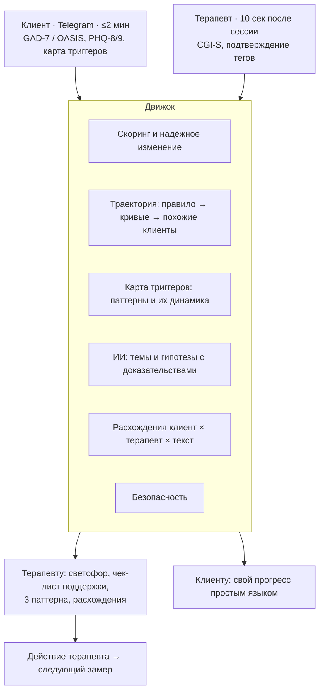

# mbc-anxiety-ru

**Метрика прогресса для КПТ-работы с тревогой: видеть, помогает ли терапия, — и замечать ухудшение раньше, чем его заметит терапевт.**

> **Статус:** v0.1 — движок метрики, спецификации и исследовательский протокол.
> Активная разработка на паузе. Issues и предложения приветствуются.

---

## Зачем

Терапевты плохо замечают, когда клиенту становится хуже: в исследовании Hannan et al. (2005)
из 40 клиентов, состояние которых реально ухудшилось, терапевты верно предсказали одного.
Регулярный замер исхода с обратной связью (measurement-based care, MBC) помогает прежде всего
тем, кто идёт хуже ожидаемого (de Jong et al., 2021).

За рубежом MBC — зрелая индустрия. Для русскоязычной практики почти нет инструментов, которые
опираются на валидизированные русские шкалы и учитывают реальный рабочий процесс терапевта.
Этот проект — попытка собрать такой инструмент по правилам доказательной психодиагностики.

## Что внутри

| Компонент | Где | Состояние |
|---|---|---|
| Скоринг шкал (GAD-7, PHQ-9/8, OASIS, WSAS) | `src/mbc/scoring.py` | ✅ протестировано |
| Индекс надёжного изменения (Jacobson & Truax) | `src/mbc/reliable_change.py` | ✅ |
| Клинический статус по логике NHS Talking Therapies | `src/mbc/status.py` | ✅ |
| Сигнал «хуже ожидаемого» — правило уровня 4а | `src/mbc/trajectory.py` | ✅ эвристика, не валидировано |
| Сигнал безопасности (PHQ-9, пункт 9) | `src/mbc/safety.py` | ✅ |
| Карта триггеров: ABC-записи, паттерны, недельная динамика | `src/mbc/triggers.py` | ✅ |
| Контракт гипотез ИИ с обязательной альтернативой | `src/mbc/hypotheses.py`, `prompts/` | ✅ без вызова модели |
| Отчёт для терапевта: светофор, статус, паттерны, телесные факторы | `src/mbc/report.py` | ✅ |
| Реестр 51 методики (рус. и зап.) + калькулятор RCI | `docs/03_measures_registry.*` | ✅ |
| Протокол межкультурной адаптации OASIS (ITC 2017) | `docs/04_…`, `research/oasis_stage0/` | этап 0 подготовлен |
| Гайд глубинных интервью с терапевтами | `docs/01_therapist_interviews.md` | готов к полю |

## Архитектура



Подробно — [`docs/04_project_mbc_anxiety.md`](docs/04_project_mbc_anxiety.md) и [`docs/05_engine_spec.md`](docs/05_engine_spec.md).

## Быстрый старт

```bash
git clone https://github.com/youngolegi/mbc-anxiety-ru.git
cd mbc-anxiety-ru
python -m pip install -e ".[dev]"
pytest -q                 # 150 тестов
python examples/demo.py   # демонстрация на синтетических данных
```

Фрагмент вывода демонстрации:

```
сессия 4: 12 (умеренная) → отстаёт от ожидаемого: к сессии 4 нет надёжного улучшения (порог 4)
сессия 6:  7 (лёгкая)    → на траектории
Итог по GAD-7: 15 → 7 — надёжное выздоровление

Динамика паттерна «before=звонок матери» по неделям:
  2026-W37: эпизодов 2, средняя интенсивность 8.5, избегание 100%
  2026-W40: эпизодов 2, средняя интенсивность 4.5, избегание 0%
```

## Принципы

1. **В репозитории нет данных клиентов и участников исследований.** Никогда.
2. **Нет текстов пунктов шкал.** Только структура и пороги — до получения разрешений правообладателей.
3. **Каждый порог — с источником.** Пороги из англоязычных выборок помечены как временные до пересчёта на русских данных.
4. **ИИ — генератор гипотез для терапевта, а не советчик клиенту.** Каждая гипотеза опирается на конкретные записи и содержит альтернативное объяснение.
5. **Прогресс паттерна — это интенсивность и избегание, а не частота.** В хорошей терапии клиент перестаёт избегать, и встреч с триггером может стать больше.
6. **Эпистемическая разметка в документах:** [замер] / [интерпретация автора] / [моя склейка]; статус доказательности — твёрдо / умеренно / шатко.

## Исследовательский трек: русская версия OASIS

Межкультурная адаптация по стандарту ITC (2017): предусловия → перевод → экспертная комиссия →
когнитивные интервью → пилот → структура и надёжность → инвариантность измерения → нормы →
**чувствительность к изменениям** → публикация. Последний этап критичен для мониторинга и чаще
всего пропускается. Пакет этапа 0 (письмо авторам, протокол поиска, пререгистрация, согласие) —
в [`research/oasis_stage0/`](research/oasis_stage0/).

## Ограничения

- Это не медицинское изделие и не инструмент диагностики.
- Правило траектории — эвристика; кривые ожидаемого ответа появятся только с данными.
- Пороги GAD-7 и PHQ-9 взяты из практики NHS и не пересчитаны на русских выборках.
- До подключения реальных пользователей нужны юридическая проверка (152-ФЗ) и протокол безопасности.

## Дорожная карта

[`ROADMAP.md`](ROADMAP.md) — треки, статусы, журнал решений и готовые задачи для следующих сессий.

## Автор

**Олег** — психолог (психология служебной деятельности), КПТ; поведенческие исследования, ИИ-продукты, продуктовая аналитика.
Telegram: [@youngolegi](https://t.me/youngolegi) · Email: [okopylov001@gmail.com](mailto:okopylov001@gmail.com)

## Лицензия

Код — MIT (см. `LICENSE`). Документы в `docs/` и `research/` — CC BY 4.0.
